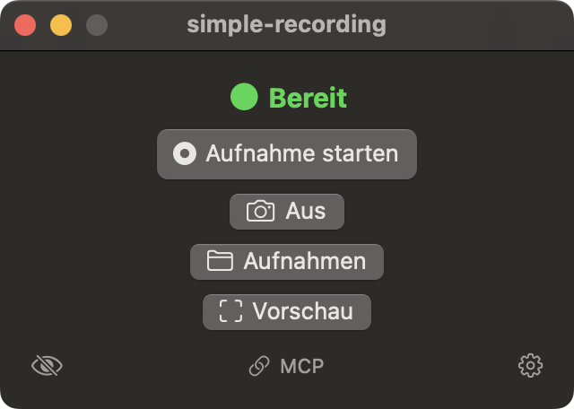
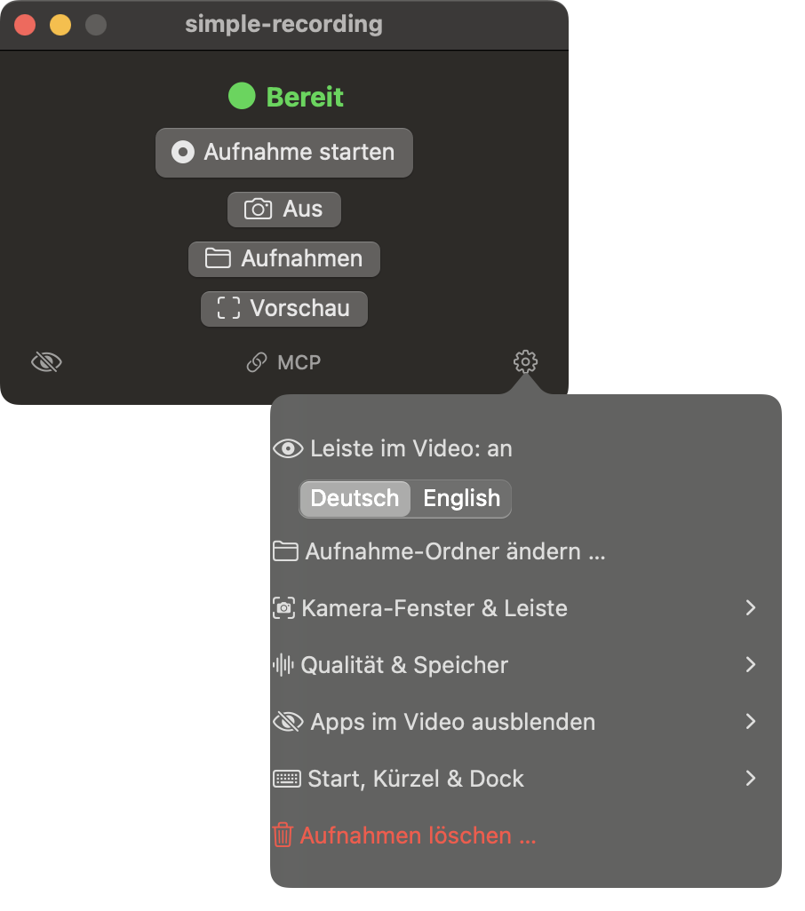
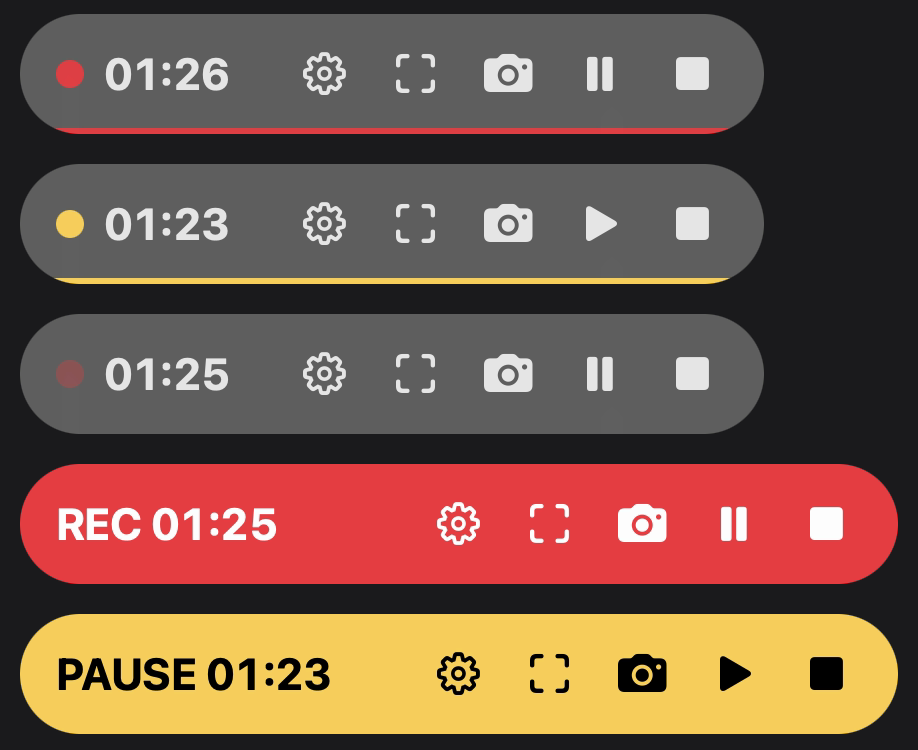
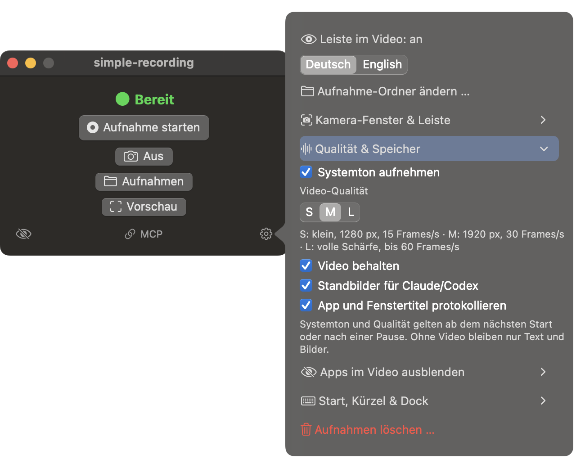
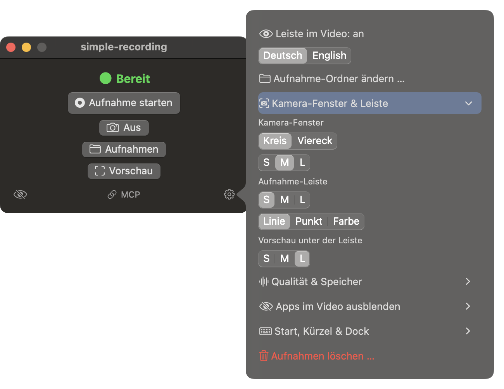
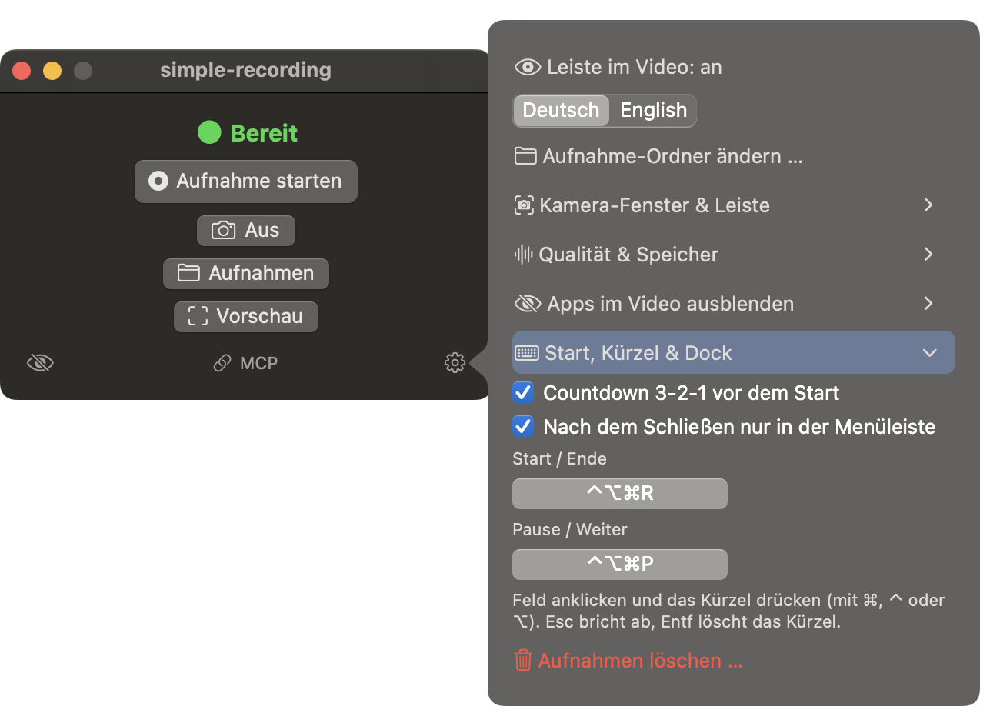
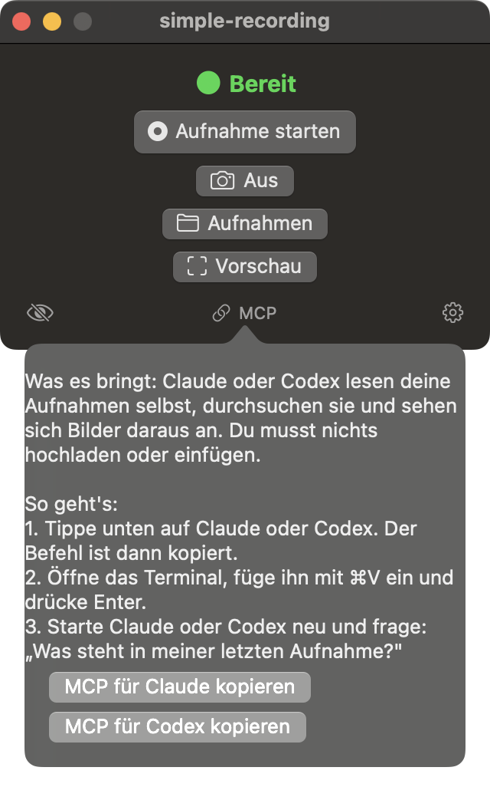

# simple-recording

A tiny, native macOS meeting recorder that turns every recording into something an AI agent can read. Everything runs locally on your Mac.

> **Status:** in development, not released yet. The source code is private.

## What it does

- Records your screen, system sound and microphone, or only your camera in full frame, while you keep using the screen.
- Pause and resume, countdown, global shortcuts, a movable camera bubble.
- Hide chosen apps (for example notifications) from the video.
- After the recording it creates, locally:
  - a transcript with timestamps,
  - the text that was visible on screen (OCR),
  - which app and window were in front,
  - one timeline file, `verlauf.md`, that puts all of it together so an agent reads one file instead of opening hundreds of images.
- An MCP server lets Claude and Codex list, search and read your recordings.

## Why it is different

Most recorders only produce a video file. simple-recording produces a video **and** a text timeline that an agent can search, without uploading anything.

## Measured

On an Apple M1 with macOS 15.7, idle (no recording running):

| | |
|---|---|
| App size | about 1.2 MB |
| Memory | about 27 MB |
| CPU | about 0.7 % |

I have not yet measured memory and CPU during a long recording or while transcribing.

## Requirements

- macOS 15 or newer
- Apple Silicon (built and tested on an M1 only)

## Built with

Swift and AppKit, ScreenCaptureKit, Vision (OCR), mlx-whisper, ffmpeg, and the Model Context Protocol.

## Screenshots

The interface is shown in German. English is available in the settings. The screenshots come from a demo mode of the app that makes its own windows capturable; no real recording was running.

**Recording bar** in three styles (line, dot, color), recording and paused:

## Video

[Walkthrough (34 s, MP4)](video/walkthrough.mp4) is a slideshow of the screenshots above with captions. It is **not** a live screen recording. A live demo is still to come.

## License

The source code is proprietary. All rights reserved.
